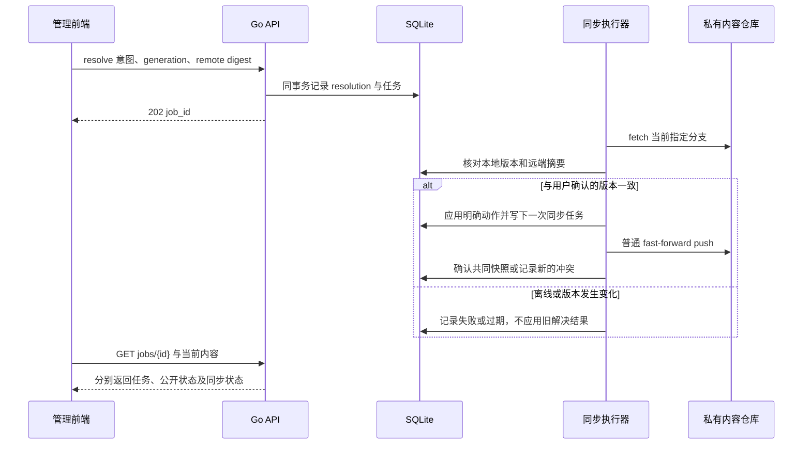

# API 详细设计

版本：1.0，2026-11-15。首版合同采用 OpenAPI 3.1.1，包含 48 个路径、58 个 HTTP 操作、80 个 schema。定义文件为 [openapi.yaml](../../contracts/openapi.yaml)，完整清单见[操作与 Schema 目录](api-endpoints.md)。此文件可导入支持 OpenAPI 3.1 的接口工具；尚无生产 API 地址。

选择 OpenAPI 3.1.1 是本项目合同版本，不表示它是最新规范；使用该规范定义请求、响应、参数和认证边界。[OpenAPI 官方规范](https://spec.openapis.org/oas/v3.1.1.html)

## 1 分组及责任

| 分组 | 能力 | 主要约束 |
| --- | --- | --- |
| 公开站点与首页 | 名称介绍、个人资料、技术生活文章、精选项目组合 | 只取公开版本，首页每组最多 6 条 |
| 公开内容 | 文章搜索、分类标签筛选、项目、技能、详情、站点地图 | 规范路径与元信息不含草稿，旧链接先检查公开状态 |
| 公开互动 | 根留言列表、分页平铺回复、匿名提交 | 无需登录，昵称不构成身份，不返回邮箱 |
| 认证 | 登录、查询会话、退出 | 唯一站主，Cookie + CSRF，退出使服务端会话失效 |
| 内容管理 | 新建、完整保存修改稿、丢弃修改稿、发布、撤回 | expected_generation + Idempotency-Key；发布状态与同步状态独立 |
| 回收站 | 移入、恢复、删除影响、彻底删除 | 恢复未发布；彻底删除需影响 token 和明确确认 |
| 分类标签 | 目录查询/创建、变更影响预览、确认应用 | 改名/删除分别更新当前公开版和修改稿快照，不发布未公开修改 |
| 评论管理 | 查询、站主回复、隐藏恢复、删除影响、删除 | 管理 DTO 才有邮箱；整组操作校验线程 generation |
| 图片 | 上传、列表、详情、私有预览、无引用删除 | 按实际文件校验；受控公开访问走 /media |
| 同步 | 概览、对账、任务、重试、冲突、提交解决意图 | 长操作返回 202；只在 worker 验证两端后应用解决结果 |
| 配置 | 站点配置、仓库连接、访问检查 | 不传输密钥；切换已有同步身份须迁移，不能自动覆盖 |

OpenAPI 中列出的 schema 包含每个字段的类型、required、null、最大长度和枚举。请求跨字段与当前状态规则还须执行[交互约定](interaction-contract.md)和本文件对应流程；结构校验不能代替权限、generation 或数据库事务。

## 2 参数与排序

| 操作 | 查询参数 | 排序与行为 |
| --- | --- | --- |
| 公开文章 | page/page_size、q、channel、category_id、tag_id | 首次发布时间 DESC,id DESC；过滤条件取 AND；q 只查标题摘要 |
| 公开项目 | page/page_size、featured | display_order ASC,首次发布时间 DESC,id DESC |
| 公开技能 | page/page_size、group | display_order ASC,id ASC，前端按 group_name 分组 |
| 公开分类标签 | page/page_size、kind、channel | 展示当前公开文章引用项，不出现仅草稿使用的目录项 |
| 根留言 | page/page_size、scope、content_id | 根留言时间 DESC,id DESC；scope=article 必须给 content_id，guestbook 不得给 |
| 平铺回复 | page/page_size，路径根评论 id | 时间 ASC,id ASC；根和所属文章不可公开时 404 |
| 后台内容 | page/page_size、kind、lifecycle、visibility、q | updated_at DESC,id DESC；默认 active；查询 trash 进入回收站 |
| 后台评论 | page/page_size、scope、content_id、state、thread_id | 时间 DESC,id DESC；state 是自身状态，effective_visible 综合父级 |
| 后台图片/任务/冲突 | page/page_size；任务 state/content_id，冲突 state | created_at DESC,id DESC；同时间必须有稳定次排序 |
| 后台目录 | page/page_size、kind、include_retired | display_order ASC,id ASC；默认不包含退休项 |

无效页号、枚举或查询结构返回 400。公开查询不接受任意字段排序、SQL 表名或表达式。空 q 作为普通文章列表；搜索页面在用户未输入时自行展示输入引导。

## 3 内容字段映射

ContentDraft 通过 kind 区分 article/project/profile/skill；共同字段为 title、summary、markdown、slug、display_order、cover、links、related_content_ids、body_asset_sha256s。它们都是完整修改稿的一部分，PUT 时必须完整提交。

| API 字段 | 数据库位置 | 规则 |
| --- | --- | --- |
| id/kind/generation/visibility/lifecycle | content_objects | 身份与状态由服务管理，不接受任意 PATCH |
| title/summary/markdown/slug/display_order | content_revisions | draft 与 published 各自一份，不互相拼接 |
| cover.sha256 / cover.alt | content_revisions.cover_sha256 / cover_alt | null 表示没有封面，profile 为头像 |
| article.details.channel | article_revision_data | 草稿可 null，发布必须 tech/life |
| article.category_id / tag_ids | revision_taxonomy + taxonomy_items | 保存时形成名称快照；导出使用快照 |
| project.details | project_revision_data | role、started_on、ended_on、featured、tech_stack |
| profile.details | profile_revision_data | location、occupation，均是主动公开的资料 |
| skill.details | skill_revision_data | group_name；实践说明使用 summary，详述使用 markdown |
| links | revision_links | 最多 20 条有序公开链接，label+url |
| related_content_ids | revision_relations | 最多 50 个去重目标；拒绝自关联；公开投影过滤非公开对象 |
| body_asset_sha256s | revision_assets | 最多 200 个；后端解析实际正文并校验一致 |
| body_html/toc | revision_renderings | 只读派生值；管理预览和公开正文统一算法，图片访问路径按场景区分 |

公开 PublicContent 有正文 HTML 和相关内容链接，但没有 Markdown 原文、草稿、generation 或同步信息。管理 Revision 提供原文与编辑字段；私有 preview_url 只供管理界面，不能进入公开页面。

## 4 保存与发布示例

创建文章，`POST /api/v1/admin/contents`：

```json
{
  "draft": {
    "kind": "article",
    "title": "我的第一篇文章",
    "summary": "开始记录技术与生活。",
    "markdown": "## 起点\n这是一篇示例。",
    "slug": "first-post",
    "display_order": 0,
    "cover": null,
    "links": [],
    "related_content_ids": [],
    "body_asset_sha256s": [],
    "details": { "channel": "tech" },
    "category_id": null,
    "tag_ids": []
  }
}
```

请求同时携带管理会话、X-CSRF-Token 与 Idempotency-Key。成功返回 201 AdminContent，其中 draft.id 为新版本 id，generation=1，visibility=unpublished，sync.state=pending。所有响应完整字段参照 schema，不把示例中的局部描述当作精简协议。

修改后 PUT `/admin/contents/{id}/draft`，提交 `{expected_generation,draft}`；成功用返回的新 generation 更新编辑基线。需要公开时才 POST `/admin/contents/{id}/publish`：

```json
{
  "expected_generation": 2,
  "revision_id": "019a8bc0-1000-7000-8000-000000000001"
}
```

发布选定版本；普通编辑不接受直接设置 visibility 或 published_revision_id。版本不属于该对象、已在回收站、正文不完整、图片缺失或 slug 冲突时不能发布。发布事务成功后返回 200 AdminContent，Git 不可用只体现在 sync，不把整个请求变成发布失败。

## 5 匿名互动示例

`POST /api/v1/public/comments`，带 Idempotency-Key，无需账号：

```json
{
  "target": { "scope": "guestbook", "content_id": null },
  "reply_to_id": null,
  "nickname": "访客",
  "body": "很喜欢这里的生活记录。",
  "email": "visitor@example.test"
}
```

响应为 201 PublicComment，只有 id、thread_id、is_root、reply_to_id、reply_to_nickname、nickname、body、author_kind、created_at。响应没有 email，写入前验证实际父级状态。reply_to_id 非 null 时服务找到其线程，检查 target 一致，禁止跨文章或跨留言板回复。

站主使用 POST `/admin/comments`，请求只有 target、reply_to_id 和 body。名称取公开个人名称，没有公开名称时使用“站主”；不能让访客填写同名昵称得到 owner 标识。

## 6 错误格式与业务码

```json
{
  "code": "CONTENT_VERSION_CONFLICT",
  "message": "内容已被更新，请比较最新版本后重试。",
  "field_errors": [],
  "request_id": "req-example",
  "current_generation": 4
}
```

| HTTP | 业务码示例 | 前端行为 |
| --- | --- | --- |
| 400 | INVALID_REQUEST | 纠正请求结构；不重试 |
| 401 | AUTH_REQUIRED / SESSION_EXPIRED / INVALID_CREDENTIALS | 显示登录或凭据错误，保留未保存输入 |
| 403 | CSRF_REJECTED / ORIGIN_REJECTED | 提示刷新会话或请求来源错误，不循环重试 |
| 404 | NOT_FOUND | 统一表示对象不存在或不可公开；不透露草稿存在性 |
| 409 | CONTENT_VERSION_CONFLICT / THREAD_VERSION_CONFLICT | 重新获取内容/线程版本，由用户比较后再提交 |
| 409 | IDEMPOTENCY_KEY_REUSED | 同键载荷不同；纠正客户端提交生命周期 |
| 409 | SLUG_IN_USE / ASSET_REFERENCED / CONTENT_STATE_CONFLICT | 展示具体约束并保留输入 |
| 409 | IMPACT_CHANGED / CONFLICT_STALE | 重新请求影响预览或三方比较 |
| 409 | REPOSITORY_MIGRATION_REQUIRED | 阻止直接切换已有仓库，进入单独迁移维护流程 |
| 413/415 | PAYLOAD_TOO_LARGE / UNSUPPORTED_MEDIA_TYPE | 告知大小或格式限制 |
| 422 | VALIDATION_FAILED / PUBLISH_INCOMPLETE | 关联 field_errors.path；保存不完整草稿与发布校验分别处理 |
| 429 | RATE_LIMITED | 读取 Retry-After，保留输入并等待 |
| 503 | SERVICE_UNAVAILABLE / DATABASE_BUSY | 查询可有限重试；写入结果不明时复用原幂等键 |

field_errors.path 使用 JSON Pointer，例如 `/draft/title`、`/draft/details/channel`。current_generation、conflict_id 为特定冲突的可选字段，不给出原始 SQL、文件路径或仓库凭据。

## 7 删除、恢复与影响确认

`trash` 只移入回收站并立即下线；`restore` 保持 unpublished。彻底删除先 GET purge-impact，返回版本数、评论数、资源关系数及 impact_token；确认后 POST purge，带 expected_generation、impact_token、confirm=true。

token 绑定操作者、对象、动作、对象/线程版本与影响清单，以服务端 HMAC 签名，5 分钟到期，不需要新建 token 表。提交时重新计算影响并核验签名，不接受前端自报计数。删除过程中评论变化或内容更新则 409 IMPACT_CHANGED。图片引用数不是“将删除的图片数”，共享原图继续保留。

评论整组删除用线程 generation 保护，预览 GET delete-impact 返回 delete_count；提交后删除根则删除整个线程，删除普通回复则只删该条。业务操作确认由产品页面执行，API 也要求明确 confirm 字段。

## 8 同步解决与任务查询



重试只允许失败任务，执行时重新读取当前对象与仓库；冲突不通过 retry 绕过。重复请求返回同一个入队结果，不生成多份解决意图。resolve 的 action 必须显式提交，不能通过选中 remote 自动触发发布或删除。

## 9 配置与非 API 操作

站点设置 title/description/timezone 可由管理 API 修改，属于管理配置，不进入 Markdown 仓库。仓库首次 PUT 的 expected_generation=0；之后修改 enabled 或轮询周期使用当前版本。已有共同基线/冲突/待执行任务时，不允许直接换 remote、branch、content_dir 或 credential_ref，避免意外将已有内容写进另一个仓库；单独迁移方案在实际需要时制定。

凭据通过服务器预置别名选择，API 不接收私钥或 token 正文。check 返回 202，执行只检查读取与分支可用性，不以“连接检查”为名推送内容；写权限是否满足在真实同步技术切片中确认。

账号初始化、重置密码、备份恢复、数据库迁移和部署健康检查属于运维 CLI/内部端口，不开放为匿名 REST API。首版自动同步通过轮询；仓库提供方尚未确定，因此没有对外 webhook 接口，repo_events 表为后续适配预留。

## 10 合同验证与后续实现

`tools/scripts/validate_design.py` 检查 OpenAPI 结构、请求正反例、管理鉴权声明、CSRF、幂等标记及公开响应字段。它不证明运行时 handler 已实现合同；开发后必须增加实际 HTTP 请求验证，特别是 HTTP 状态、Cookie、跨源策略和所有业务错误码。

前端类型生成采用 OpenAPI 为唯一来源，生成文件不得手改。修改条件 schema 时要验证 `openapi-typescript` 能表达哪些分支；例如生成的类型不能完整表达 `ResolveConflict` 的条件约束，Go 仍须按合同校验。所有新 API 变更通过兼容检查后才能独立发布。
