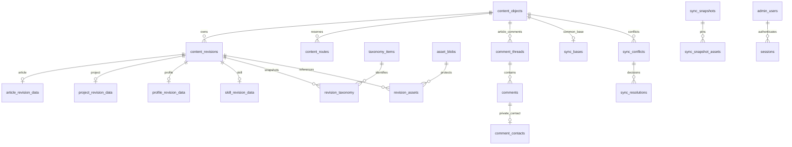

# 数据库详细设计

版本：1.0，2026-11-15。数据库选用 SQLite，字段与约束的可执行定义见 [00001_initial.sql](../../backend/migrations/00001_initial.sql)，每列说明见[逐表字典](database-tables.md)。32 张表包含类型扩展表、关联表及任务/会话基础表，仍由一个 Go 应用和一份 SQLite 文件管理。

## 1 连接与基础类型

- 数据文件使用本机持久盘；开启 WAL、foreign_keys、busy_timeout=5000。每个连接都启用外键，不能只在迁移连接执行一次；写事务前确认已启用。
- 写连接池 max_open_conns=1；读池初始为 4。写连接使用 `BEGIN IMMEDIATE` 或驱动等价事务配置，避免先读后升写的竞态；Go 事务 API 的实际行为在驱动集成测试中核验。
- STRICT 表只使用 TEXT、INTEGER、BLOB 等 SQLite 允许类型；布尔使用 INTEGER 0/1，JSON 使用有 json_valid/json_type 检查的 TEXT。
- `*_at` 为 UTC Unix 毫秒 INTEGER，API 转为 RFC3339；日期字段 started_on/ended_on 为 YYYY-MM-DD，业务校验真实日期。UUID 文本保持小写规范格式，SQL 不负责完整 UUID 语法。
- 迁移由 Goose 管理，其版本表不包含在 32 张业务表统计中。迁移必须在空库及升级副本上执行，禁止直接手改生产表。

SQLite 的外键启用、延迟约束、STRICT 表和部分唯一索引的具体行为以官方说明为依据。[外键](https://www.sqlite.org/foreignkeys.html)、[STRICT](https://www.sqlite.org/stricttables.html)、[部分索引](https://www.sqlite.org/partialindex.html)

## 2 实体关系

图省略派生 HTML、外部链接、关联内容、配置、审计和任务表；完整结构在 SQL 与字典中。published_revision_id/draft_revision_id 指回所属对象的版本，使用 `(content_id,id)` 复合外键禁止指向别人的版本，并延迟到事务提交时校验。

## 3 内容对象与版本

### 3.1 对象层

`content_objects` 保存身份、kind、lifecycle、visibility、两个版本指针、generation 和发布时间。kind 是 article/project/profile/skill，创建后不可改；技术/生活是 article 子字段，可通过发布修改稿切换而不改变对象 id。

- lifecycle 仅 active/trash；visibility 仅 unpublished/published。trash 必须 unpublished，仅文章和项目可进回收站。
- published_revision_id 在撤回/回收站后仍保存最后公开版本，但查询必须同时检查 lifecycle 与 visibility；它本身不代表仍公开。
- 草稿状态由两个指针与 visibility 推导，不另存“draft、published_with_draft”等重复状态。
- first_published_at 只在首次发布确定；published_updated_at 仅在影响公开内容时更新；updated_at 反映后台对象变化。
- 全站最多一个 profile；每个技能为一个 skill 对象。个人资料和技能通过撤回下线，首版不提供其回收站/彻底删除操作。
- 所有成功内容变更增加 generation，包括草稿、公开状态、分类批量迁移和仓库导入；纯任务重试不增加内容 generation。

### 3.2 版本层

`content_revisions` 保存标题、摘要、Markdown、候选 slug、展示顺序和封面，版本序号只在当前对象内递增。正文 HTML 和目录存入 `revision_renderings`，按 `(revision_id,renderer_version)` 区分，渲染器升级不修改原始版本。

四个类型扩展表保存各自字段：文章频道与搜索归一化文本；项目角色、时间、精选与技术栈；资料所在地与职业；技能分组。每个版本必须恰有匹配 kind 的扩展行，由同一应用事务保证。

关联表保存版本专属的分类标签快照、正文图片、外部链接和关联内容。`cover_alt`、链接标签、技能实践说明也属于版本，不从草稿拼到公开响应。资料的 title/summary/cover 分别代表显示名/短介绍/头像；技能的 title/summary 为名称/实践说明。

版本插入后业务上不可变；SQL trigger 禁止主版本 UPDATE。扩展表、关系和原文的不可变写入纪律由服务实现与事务测试保证；不能声称仅主表 trigger 已覆盖所有子表。派生 rendering 可新增新版本记录。物理删除只在对象彻底删除或明确的历史保留策略中发生，首版不自动删历史。

revision_relations.target_content_id 不设外键，保留历史原始关联。公开查询只投影仍存在且公开的目标，不递归展开，不会暴露撤回对象标题。删除目标后，旧快照保留其 id，但页面不产生无效链接。

### 3.3 分类与标签

`taxonomy_items` 是可供编辑选择的目录，唯一性由 kind/channel/normalized_name 及 kind/channel/slug 约束。规范化采用 trim 与 Unicode case fold，由 Go 计算。分类仅 tech 或 life；标签固定 all。

`revision_taxonomy` 保存 id、名称、slug、频道的版本快照。部分唯一索引保证一个版本最多一个分类；业务检查仅文章可分类，分类频道匹配、标签数不超过 20。保存草稿按当前目录生成快照，仓库导入必须保留文件所写快照或拒绝冲突，不能悄悄用当前目录名称替换。

仓库首次引用未知分类 id 时可创建目录；同 id 的 kind/channel 不符时拒绝。名称变化只作用于导入的内容版本快照，不批量改其他文章；已有目录名称保持原值，后台提示该版本名称与目录不同，站主可显式执行目录改名或采用当前目录重存修改稿。导出使用版本快照，保证往返不丢字段。

改名/删除需要明确批量操作。用受影响对象的当前公开版和修改稿分别派生新版本，再原子移动指针、增加 generation、写同步任务；旧历史不改。删除是目录退休，允许迁移或移除当前关联，保留旧快照的外键。指向退休项的历史版本再次发布时要求先保存新修改稿处理分类，不能重启已删除标签。

## 4 链接与图片

### 4.1 链接保留

`content_routes` 主键为 `(namespace,slug)`，namespace 仅 posts/projects；每个对象最多一个当前路由。候选 slug 存在 revision，只有发布时才占用/变更路由，保存草稿不改当前公开地址。

发布 slug 修改时先验证新路由没有被其他对象占用，再把旧路由设为非当前并插入/恢复新路由。历史路由持续保留到彻底删除，不能被其他对象复用。公开解析先确认对象可见，再决定正常返回或 308；撤回后所有路由均 404。

恢复不释放或重占已有路由，保持原 id；缺失路由或有历史外部迁移冲突时，在再次发布时明确报错，不覆盖其他对象。profile 与 skill 不创建独立路由，其链接定位到 about 页面。

### 4.2 资源生命周期

原图按 SHA-256 存 `asset_blobs`，同内容复用一份物理文件；storage_key 为服务生成的相对存储键，绝不接受用户任意文件路径。文件先写临时位置、解码验证、按摘要原子落盘，再提交数据库记录。数据库提交失败留下的孤立文件由维护清理收回。

`revision_assets` 是解析 Markdown 得到的实际引用集合，客户端传来的集合用于一致性校验，不能用它声明任意图片公开。封面由 content_revisions.cover_sha256 单独关联。`asset_variants` 记录 thumb/reading 任务结果，不进入内容仓库；原图进入仓库并保留。

资源回收必须同时检查封面、所有保留 revision、sync_snapshot_assets 及待处理手动合并结果的引用。历史和回收站均有保护；同步冲突的一端即使未进入内容版本，也要通过同步快照固定资源。manual 解决意图入库时先形成目标预备 snapshot 并固定其资源。

DELETE media 只在零引用时允许；事务删除元数据并写 delete_asset 任务，之后受控执行物理删除。新的同 hash 上传与删除任务按资产锁串行；任务再次检查当前元数据和引用，防止延迟删除刚重新上传的文件。

## 5 评论数据

每条根留言对应一个 `comment_threads`，文章线程绑定 content_id，留言板线程 content_id=null。`comments.is_root` 表示根留言，唯一索引保证每线程最多一个根；创建线程和根留言必须在同一事务，服务保证至少一个根。

回复的 reply_to_id 指向同线程任意可见评论，trigger 拒绝跨线程。UI 全部平铺。reply_to_nickname 保存提交时的目标昵称；单条回复删除导致引用 id 设 null，昵称继续可显示。根删除通过删除整个 thread 执行，以级联删除所有回复和私密邮箱。

可见性规则为评论自身 visible、根 visible、文章仍公开（留言板不要求文章）；`public_comments` 视图体现此规则。公开计数必须来自相同筛选。隐藏根不批量改回复 state，恢复才不会误恢复原先单独隐藏的回复。

`comment_contacts` 与 comments 一对零/一，唯一保存可选邮箱。查询公开 DTO 不能 join contacts，也不使用 `SELECT *` 直接序列化；管理查询经过会话校验才选择该字段。线程 generation 受所有评论写操作影响，CAS 校验必须在写事务中执行。

## 6 同步与任务

### 6.1 快照与共同基线

`sync_snapshots` 保存规范化对象 JSON 与 digest。payload 包含对象身份、存在/删除状态、公开状态、首次发布时间、完整公开版、修改稿和各自分类/资产信息；结构与 API SyncSnapshot 对应，存储时 digest 独立列。

摘要计算前固定键顺序、规范化换行、按语义规范化无序集合；不包含数据库 revision id、revision_no、渲染 HTML、任务时间、generation、摘要自身等本地派生字段。有顺序含义的链接、展示顺序及正文不得重排。数据库内容版本 digest 使用同一字段约定。

`sync_bases` 只保存实际两端已收敛的快照及确认的 Git commit；`sync_conflicts` 固定 B/L/R、当地 generation 和远端 commit。不同对象可以独立成功。B 为空表示尚无共同版本；两端独立创建同 id 且不同仍须冲突。

内容仓库 object.json 中 `kind` 统一为 article/project/profile/skill，目录沿用 posts/projects/profile/skills。完整版本包括本设计 ContentDraft 字段、分类快照及资源；本地数据库版本 id 不写入仓库。首版拒绝未识别字段，错误指出路径，不能在导出时静默丢弃。

### 6.2 任务与崩溃恢复

`outbox_jobs` 保存 kind、对象/资源/解决意图 id、目标 generation、dedupe_key、租约和重试信息。aggregate_id 不设内容外键：彻底删除后，删除远端的任务仍需存在。payload 只保存执行所需标识与少量参数，不保存邮箱、密码或完整请求体。

- dedupe_key 示例 `sync:<content_id>:<generation>`、`resolve:<resolution_id>`，防止同一次变更重复派发。
- queued/retry_wait 到期后短事务领取，设 running + 随机 lease_token + lease_expires_at；完成只允许匹配 token 的持有者更新。
- 仓库进程级文件锁提供单机互斥；数据库租约用于崩溃恢复，不能代替多机锁。执行超过租约时续租，丢失租约立即停止后续提交。
- Git I/O 在事务外。push 成功后才更新共同基线，且只对应真正推送的 generation。网站已更新则新版本继续待同步。
- 崩溃发生在 push 后、DB 标记前：重新 fetch 并按摘要识别收敛，不重复提交。旧任务不能回滚新发布、撤回或删除。
- 网络错误有限退避；认证错误标 failed 等人工修复。retry 新任务重新比较最新状态，原任务保留审计，不把旧 payload 当权威。
- repo_events 为未来通知适配保留；首版轮询即可自动同步，没有开放未经设计的 webhook 接口。接到事件也仅触发读取当前 HEAD。

### 6.3 人工解决

`sync_resolutions` 持久化选择、动作、预期网站 generation 和已确认远端 digest。resolve API 返回 202，执行器核对两端后才应用本地事务。若仓库失联或版本已变，本地不做解决动作。

应用后保留 applied_generation 与 target_snapshot_id。下次同步允许按该明确授权结果替换已确认的远端对象，但必须检查远端仍等于 expected_remote_digest；不能把共同基线提前改成一个两端尚未收敛的状态来绕过冲突。普通 push 被拒绝时重新检查，远端有新变化则重新进入冲突。

网站解决结果与远端一致并 push/确认完成后，才推进 sync_bases 并清理不再被引用的预备快照。resolved 表示人工选择已在本地应用，同步状态仍可能 pending/failed，两者分别展示。

## 7 关键事务

| 操作 | 同一事务中必须完成 | 事务外操作 |
| --- | --- | --- |
| 创建/保存修改稿 | 校验目标 generation，插版本与类型/关系，移动 draft，增加 generation，写 outbox/审计/幂等 | 预处理 Markdown、图片和摘要；提交前再验证基线 |
| 发布 | 检查拟发布版本、渲染记录与资源，预占路由，更新 published 与时间，处理 draft 指针，写 outbox/审计/幂等 | Git push |
| 撤回/回收站 | CAS 更新状态与 generation，保留版本/评论，写 outbox/审计/幂等 | 远端撤回或删除文件 |
| 恢复 | CAS 改 active + unpublished，清 trashed_at，保留身份关系，写 outbox/幂等 | 导出未发布对象 |
| 彻底删除 | 校验影响 token，增加最终 generation，删除冲突/基线及对象业务数据，写 tombstone、delete_remote 任务与幂等 | 远端删除；孤立资源清理；不清除 Git 历史 |
| 评论提交 | 验证当前公开目标，创建/更新线程版本，写评论与邮箱、幂等 | 无需 Git |
| 分类迁移 | 核验影响集合与 token，分别派生当前公开/修改稿版本，更新目录及对象 generation，为每对象写 outbox | 仓库分别同步，失败不回退网站 |
| 应用解决意图 | 再核网站 generation，应用明确动作、记录解决后的 target snapshot，写后续同步任务与审计 | 先 fetch 验远端；后普通 push |

所有 SQL 修改使用参数绑定。错误、FK 失败、CAS 不匹配、幂等唯一竞争均回滚整笔事务；不能捕获错误后继续提交其余部分。sqlite busy 返回可重试故障，前端复用幂等键。

彻底删除时，先移除指向对象快照的 conflict/resolution/base，再删除对象；仅清理没有其他引用的 sync_snapshots。tombstone 只含 id、kind、最终 generation、删除时间与远端确认时间，长期保留；旧仓库文件不能重建该 id。关联目标 id 可以留在其他对象历史中，但公开读取过滤失效目标。

idempotency_records.resource_id 用于内容/评论删除时清除其旧响应；删除根线程时先取出所有评论 id 清理其记录。最终删除动作自身的 204 幂等记录可保留，不含被删正文。管理写响应可能包含修改稿，因此幂等表与主数据库具有相同的私有访问边界。

## 8 约束落点

| 不变量 | SQL 已定义 | 服务必须补齐 |
| --- | --- | --- |
| 发布指针属于本对象 | 复合延迟 FK | 发布版本完整、渲染与文件可用 |
| 草稿不影响公开 | 分离指针、公开投影视图 | 所有公开 DTO 只读公开投影和对应关系 |
| 回收站不能公开 | CHECK | 恢复动作仍 unpublished |
| 分类最多一个 | 部分唯一索引 | 分类频道匹配、标签数量、退休项处理 |
| 版本不可变 | 主版本禁止 UPDATE | 类型/关系表不可改写，派生新快照 |
| 不出现跨线程回复 | FK + trigger | 目标仍可见、根存在、线程版本递增 |
| 站主不可伪造 | author_kind 枚举 | 公共请求禁止该字段；仅会话决定 owner |
| 图片不误删 | 外键 RESTRICT | 文件就绪、实际 Markdown 引用、待处理快照保护 |
| 同步状态不被旧任务覆盖 | generation 与任务字段 | CAS、租约 token、Git HEAD 比较与任务过期判断 |
| 彻底删除后不复活 | 独立 tombstones | 每次仓库导入先查 tombstone |

## 9 查询与索引

公开文章先过滤 active/published/kind，再按 first_published_at DESC,id DESC 分页；有频道、分类、标签筛选时 join 当前公开 revision。搜索在 article_revision_data 的 search_title/search_summary 上做字面包含，不查正文；通配符须转义，不能把用户 `%` 当任意匹配。首版不加全文索引，明确在测试数据规模下评估扫描成本。

后台按 lifecycle/kind/updated_at 查；回收站使用同一对象表，无需复制一份内容。对象历史通过 `(content_id,revision_no)` 查；路由按主键查；评论按来源与线程时间索引；任务按 state/next_run_at 领取。外键常用反向查找均有索引，少量历史清理查询上线前检查 EXPLAIN QUERY PLAN。

## 10 留存与备份

内容历史、回收站、共同基线、未解决冲突和 tombstone 不自动过期。幂等记录 24 小时后清理；会话过期删除；已完成任务、事件与审计默认保留 90 天，但未完成/失败/冲突记录不随普通日志清理。记录清理不是内容或备份删除。

数据库在线备份与原图、配置一起保存，备份期间暂停物理资源清理。原图不可变，按照 DB 快照引用复制文件；不能只复制活跃 `.db` 文件。恢复时重置 running 租约、重新对账仓库，并先验证内容和评论，再恢复写入流量。
