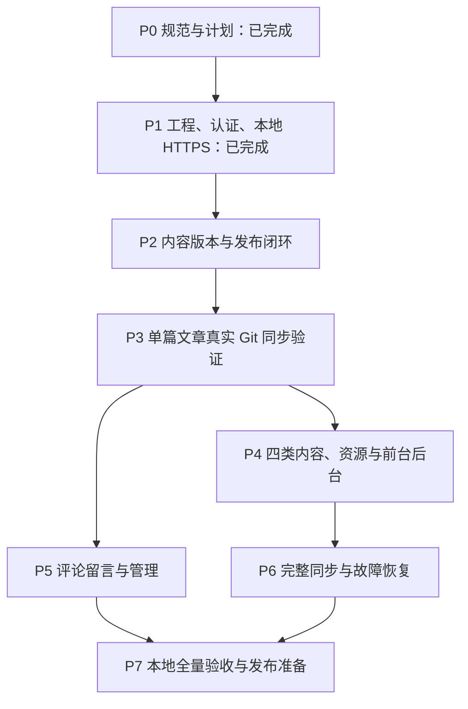

# 个人网站开发计划

版本：1.3；日期：2026-11-23。依据需求 v1.3、技术方案 v1.3、详细设计和用户要求制定；本版补充根仓库与前后端子模块协作规则，并将联调工具集中于 `tools/`、统一为 `./dev` 入口。执行规范见根目录 [AGENTS.md](../AGENTS.md)，其中明确目录、代码规范、中文注释、子代理协作和本地联调要求。

本计划集中维护开发阶段编号、任务依赖和进度。模块文档按功能描述用法，历史交付范围见根仓库的验收记录。

## 1 目标与当前状态

目标是完成一个可在本地真实服务环境验收、可独立构建和部署的前后端分离个人网站。范围覆盖六个公开入口、四类内容维护、匿名评论与留言、图片、双向 Git 同步、冲突与回收站，以及备份恢复。

| 项目 | 当前状态 | 本计划中的处理 |
| --- | --- | --- |
| 需求、原型、技术与详细设计 | 已形成；已有 32 表 SQL、58 操作 OpenAPI | 作为实现依据，发现实现障碍时同步修订合同 |
| 代码与目录规范 | 本轮已写入 `AGENTS.md` | P0 完成；后续代理先读取再开发 |
| 应用工程 | P1 已完成 Nuxt、Vue、Go 工程和站主认证，三端独立构建通过 | P2 实现内容版本与发布闭环 |
| 应用 Git 仓库 | 根仓库维护合同、文档和编排；`frontend/`、`backend/` 为 Git 子模块；`prototype/` 继续独立并被忽略 | 子模块先提交、根指针后提交；已配置 GitHub 地址，本轮未推送 |
| 项目工具 | Node 24.22.3、Go 1.27.4、pnpm 12.21.0、Caddy 2.11.9；Git 2.54.0 | 私有安装于 `var/toolchain`，摘要在 `tools/toolchain.json`；工具依赖锁在 `tools/`，入口为 `./dev` |
| 验证 | P1 检查、单元/race、构建、9 组 HTTPS 与 6 组浏览器验证通过 | [P1 证据](verification/P1-2026-11-17.md)；后续阶段分别验收 |

技术路线沿用 Nuxt 4、Vue 3、Vite 8、Node 24 LTS、Go 1.27、SQLite + modernc、Goose、Caddy。P1 已核验兼容性并固定精确版本、发行物摘要和锁文件，实际 Go 驱动 SQLite 为 3.54.1。原本机 Node 22.19.0、Go 1.27.2、失效的全局 pnpm 不作为工程依赖；未升级全局工具或部署生产服务。安装和启动见 [P1 本地开发说明](development/local-development.md)。

根目录精简与统一验收入口已通过[本地验收](verification/tools-2026-11-23.md)。`./dev verify` 执行检查、单元/race、各端构建、编排故障和一套真实服务上的浏览器/HTTP 验收，产品开发阶段保持 P2 待开始。

## 2 执行顺序与依赖

P4 与 P5 可以并行；P6 的执行器故障用例可以在 P3 后开始编写，但完成依赖 P4 的四类内容和资源能力。前端布局可以提前开发，阶段验收必须接真实后端。同步高风险流程在 P3 先证明可行，不能延后到全部页面完成才验证。

P0–P7 按需求基线和技术方案组织实施。没有固定上线日期，按退出条件推进；P1 确认工具链成本、P3 确认同步实现复杂度后再估算剩余工期。发现关键失败先修复或记录明确依赖，不以页面完成比例替代可用程度。

## 3 分阶段任务与完成条件

### P0 规范与工作拆分

状态：本轮完成。

- 将目录、语言规范、SQL 和关键代码中文注释、代理职责、合同来源、质量要求写入 `AGENTS.md`。
- 编写本计划与[本地联调规范](local-integration.md)，补文档入口。
- 区分已有设计资产、待建工程和待执行命令；规定统一的测试记录方式。

完成条件：文档链接和规则一致，没有把计划能力描述为已实现。

### P1 工程、合同和本地服务底座

状态：2026-11-17 完成本地实现与验证。P1-01–P1-07 均已交付，远程 CI 为配置完成、未执行；详见 [P1 验证记录](verification/P1-2026-11-17.md)。

依赖：P0。主代理负责根工程及共享文件；前端、后端可在边界明确后分派。

仓库拆分收尾（2026-11-23）：保留根仓库 `contracts/`、`docs/`，提取前后端历史并注册为 Git 子模块，分别建立规范、依赖及检查入口；根脚本改为跨仓库编排。退出条件包括独立构建、合同生成无漂移、真实 HTTPS/浏览器回归及子模块递归检出；迁移验证另记，不用原 P1 结果替代。

| 任务 | 具体产出 | 验收点 |
| --- | --- | --- |
| P1-01 工具与仓库 | 检查现有文件后建立应用 Git 仓库；Node/pnpm/Go 精确版本、workspace、锁文件、环境变量样例、格式与 lint 配置 | 从声明的版本安装和构建，不依赖失效的全局 pnpm；运行数据被忽略 |
| P1-02 三个工程 | `frontend/apps/web`、`frontend/apps/admin`、`backend/cmd/api`、`backend/cmd/site-admin`、共享基础 token | 三个产物独立构建；Nuxt 不实现业务 API；管理端 `/admin/` 深链接正常 |
| P1-03 合同客户端 | OpenAPI 类型生成、统一 fetch 适配器、错误码/字段错误、CSRF、幂等键、取消与超时 | 生成文件不手改；复杂条件 schema 的类型和运行时限制有验证记录 |
| P1-04 数据库底座 | modernc、Goose、读写池、WAL、每连接外键、busy timeout、事务封装、schema 版本检查 | 用实际 Go 驱动空库迁移并记录 `sqlite_version()`；回滚、复合延迟 FK 和写锁行为符合设计 |
| P1-05 站主认证 | CLI 初始化/改密、登录/会话/退出、Argon2id、Cookie、Origin/CSRF、限频、脱敏日志 | 管理端真实登录；多标签 CSRF 有效；退出/改密失效；缺失或错误凭据被后端拒绝 |
| P1-06 本地编排 | HTTPS 代理、隔离运行目录、启动/停止/状态脚本、就绪检查、测试环境入口 | 同一个 HTTPS 来源访问前后端；重启、端口冲突和失败清理可复现 |
| P1-07 质量入口 | lint、类型检查、Go vet/test、设计检查、三端构建、CI 配置 | 本地执行；远程 CI 尚未接入时明确标记“配置完成、本地通过” |

退出条件：浏览器通过本地 HTTPS（默认 `https://localhost:8443`，自动测试使用记录在证据中的动态端口）打开公开站及管理端；站主登录调用真实 Go API 和 SQLite；前后端独立构建成功。本阶段只初步验证 AC30，完整替换与兼容验收留到 P7。

### P2 内容版本与最小发布闭环

依赖：P1。共享内容服务由一个负责人实现，管理页面和公开详情可分派。

- P2-01：对象、不可变版本及类型字段、路由、渲染清洗、完整性校验；先实现文章，结构覆盖四类内容，类型扩展表和关系表的不可变性由服务补齐。
- P2-02：新建/保存/丢弃修改稿、发布明确版本、撤回、移入回收站和未发布恢复；管理端最小编辑器及公开详情接真实 API。
- P2-03：generation CAS、幂等记录、审计和 outbox 同事务；任务持久化、状态查询、租约基础；此时未接 Git 的任务明确 pending，不伪造 synced。
- P2-04：公开列表、搜索和详情只用公开快照；旧 slug 重定向先校验可见性；SSR、Open Graph、sitemap 和缓存边界纳入后续共用查询规则。
- P2-05：表单失败保留输入，区分保存/发布/同步；401、409、422 和网络结果不明分别处理。

退出条件：真实浏览器完成“登录 → 保存不完整草稿 → 补齐并发布 → 公开阅读 → 保存不同修改稿但线上不变 → 撤回 → 回收站恢复仍不公开”。并发两个会话只有一个 CAS 成功；同幂等键重放不新增版本或任务；事务失败没有半成品。本阶段对应 AC05、AC22、AC24、AC27、AC28 的本地内容部分，同步部分在 P3/P6 完成。

### P3 单篇文章的真实 Git 同步验证

依赖：P2。先用纯文字文章降低切片变量；图片和四类覆盖在 P4/P6 完成。

| 任务 | 具体产出 | 验收点 |
| --- | --- | --- |
| P3-01 固定文件协议 | 将既有协议细化为版本化 JSON Schema、Markdown front matter 规则与有效/无效样例 | 明确稳定 id、公开/修改稿字段归属、slug、时间、删除及未知字段处理，消除早期示例的歧义 |
| P3-02 导入导出 | 确定性序列化、内容摘要、路径校验、扫描和校验、快照及共同基线 | 两次无改动对账不产生空提交；移动识别同一 id；格式错误不影响现有公开版本 |
| P3-03 真实执行器 | 本地 bare remote、网站工作区、站主独立克隆；轮询、fetch、普通 push、串行锁、租约与退避 | 网站和仓库各编辑一次能双向收敛；Git 在数据库事务外执行 |
| P3-04 冲突最小界面 | B/L/R 比较、保留双方、明确 selection/action、任务状态和失败重试 | 双端编辑进入冲突；选择一版不隐含发布；远端变化使旧意图失效 |
| P3-05 故障切片 | Git 不可用、push 非快进拒绝、push 成功后确认前崩溃、旧任务重放 | 网站发布/撤回即时生效；重试不回滚、不循环提交、不丢修改 |

退出条件：后台保存/发布与站主克隆推送都通过真实 Git 触发；能演示离线恢复、冲突、仓库删除、未发布恢复以及重启后对账。记录实际 Git commit 与任务变化。P3 不满足就先解决核心状态和同步设计问题，再扩展页面数量。

### P4 完整内容管理、图片与公开页面

依赖：P3。按后端内容扩展、公开前端、管理前端分工；共享内容服务和合同由负责人集成。

- P4-01：补齐文章、项目、唯一个人资料和多条技能对象；项目链接/排序、技能分组与相关内容关系；补齐管理列表、概览、筛选、编辑、版本展示和回收站操作。
- P4-02：分类、标签目录及变更影响预览；名称/关系变更分别派生公开和修改稿快照；影响范围变化返回冲突；支持回收站保留版本的关系更新。
- P4-03：图片上传、实际格式/像素校验、去重、派生图任务、私有预览、公开授权、引用检查和安全删除；Markdown 预览与发布使用同一清洗管线。
- P4-04：Nuxt 六个入口、项目/文章详情、分类标签、标题摘要搜索、分页、目录、代码复制、图片阅读、SEO/规范链接/sitemap；技术与生活并重，保留原型的简洁温暖风格。
- P4-05：管理端站点设置、仓库配置及检查入口、素材管理；私密凭据只能引用后端配置别名；已有基线时禁止直接切换仓库。
- P4-06：回收站删除影响预览、明确确认、彻底删除、tombstone、幂等历史清理及远端删除任务；公开新旧链接和图片访问重新检查引用可见性。

退出条件：四类内容可完整维护和公开阅读；图片无法绕过公开边界；分类批量变更不发布修改稿；恢复保持未发布；360/768/1440 CSS 像素下核心页面可操作。留言板 UI 可先接 P5 接口合同，但评论功能必须等 P5 真实联调后验收。

### P5 评论、留言与管理

依赖：P3 的稳定内容/认证合同；与 P4 并行时避开共同文件。

- P5-01：文章评论和独立留言板、根分页/平铺回复分页、跨访客回复、可选私密邮箱、即时公开和幂等提交。
- P5-02：站主管理回复、身份标识、根/回复隐藏恢复、删除影响确认、线程版本校验；项目不开放评论。
- P5-03：公开输入与失败保留、限频反馈、管理查询；防止跨线程回复、伪造 owner、注入 HTML 和公开邮箱泄漏。
- P5-04：文章撤回/删除与评论可见性一致；隐藏根再恢复不能解除单回复隐藏；删除目标回复后保留引用昵称。

退出条件：两个匿名浏览器和一个站主会话完成文章及留言板互相回复和管理流程；公开 HTML/API/payload、Git、普通日志无邮箱；评论提交中目标撤回以及删除影响变化均正确拒绝。

### P6 四类内容完整同步与恢复

依赖：P4；沿用 P3 的协议和执行器，不重新建立另一套同步模块。

- P6-01：文章、项目、资料、技能及图片双向往返，分类标签快照、移动重命名、缺失 id 的合法新增回写、未知字段策略、重复 id/非法路径/缺失图片校验。已有对象丢失 id 必须报错，不能重复导入为新对象或误判原对象删除，保留现有公开版本及评论关联。
- P6-02：同步中心任务列表/失败重试、三方差异和手动合并、明确保存/发布/撤回/回收站动作；远端删除、本地删除、修改与删除冲突、意图过期和离线解决失败。
- P6-03：租约失效、重复事件、旧 generation、旧 worker、push 拒绝、崩溃重启、彻底删除后的旧仓库重放；共同基线只在实际收敛后前进。
- P6-04：图片双向同步与暂存原子性；历史/回收站/冲突/未完成意图引用保护；删除与同摘要重新上传竞争不误删。
- P6-05：调试日志脱敏、失败任务保留、到期会话/幂等和已完成任务清理；清理不得删除未完成冲突、历史、回收站和 tombstone。

退出条件：按本地联调矩阵跑通所有同步和故障场景；四类内容网站与指定分支最终一致；旧任务不会覆盖新状态、重复提交或复活已删除对象。真实远程提供方鉴权、网络延迟及推送权限在提供仓库后另验，不用本地 bare remote 结果冒充。

### P7 全量本地验收与发布准备

依赖：P4、P5、P6。

- P7-01：真实 HTTPS 环境执行完整端到端矩阵；对当前 58 个 operationId 建立实现/合同检查记录，每个 API 至少有成功及关键失败路径，新增操作同步更新清单。
- P7-02：运行实际生产构建：Nuxt Node 产物、Go 二进制、管理端静态产物经本地 Caddy 访问；不只测开发服务器。更换兼容前端时后端进程及数据库保持正常，验证 AC30。
- P7-03：备份 SQLite 一致性快照、原图及必要配置，恢复到新目录；校验内容、图片、评论、关联、任务；重置 running 租约并对账 Git，原数据库不作为验收写入目标。
- P7-04：记录 CPU/内存、软件版本、内容规模、查询/页面/同步时延和错误率；测实际驱动锁竞争、搜索、分类批量变更和多图页面。先建立本地基准，生产 SLA 依据真实服务器再定。
- P7-05：编写生产配置、systemd/Caddy、升级/回滚、迁移、备份恢复、诊断说明；账号初始化及密码重置流程可复现。
- P7-06：整理 AC01–AC30 验收证据、已知问题与部署输入；替换真实内容和部署另按用户后续范围执行。

退出条件：本地适用的 AC 全部有通过证据；没有未解决的数据丢失、草稿泄漏、权限绕过或删除复活问题；构建和恢复可复现。只完成本地验证时，交付标记“本地验收通过，生产待部署/验证”。

## 4 子代理任务分配

推荐同时保持一个集成负责人和最多三个边界明确的子任务，实际按可用并发额度调整。不是所有阶段都适合并行。

| 角色 | 主要路径/职责 | 依赖与限制 |
| --- | --- | --- |
| 主代理 / 集成负责人 | 根配置、合同、各仓库共享文件协调、子模块指针、任务分配、最终联调 | 负责冲突协调、合并与质量结论；共享文件可委托但同一时间只能有一个写入负责人 |
| 后端子代理 | 指定的 `backend/internal/<module>/`、对应测试 | 先稳定服务接口；不同代理不能同时改内容状态服务；不另起协议 |
| 公开站子代理 | `frontend/apps/web/` 和公开站用例 | 使用生成 DTO、共享 token；不修改后台业务、直接读 DB 或复制 mock 逻辑 |
| 管理端子代理 | `frontend/apps/admin/` 和管理端用例 | 按状态合同实现表单、任务及错误；共享客户端变更反馈负责人 |
| 验证 / 审查子代理 | 指定 `tools/tests/`、验证记录或只读审查 | 与实现角色轮换占用并发槽；独立测试运行目录，报告可复现失败 |

子代理只能修改分配到的仓库与路径；共享根合同、各仓库锁文件及生成客户端分别指定唯一写入负责人。前后端先完成各自提交，根仓库最后记录合同、文档与子模块指针；跨仓库功能的完成证据以根工作区整体验证为准。

每次分派包含：任务编号、目标、已满足依赖、允许修改文件、不能修改文件、服务/DTO 合同、分配端口、验证命令、交付内容。代理先交模块检查结果，主代理再对整合版本运行本地联调；不能只汇总各代理的“通过”结论。

## 5 验收映射

下表说明最终责任阶段，不表示已通过。详细操作及异常检查见[本地联调规范](local-integration.md)。

| 需求验收 | 内容 | 初次验证 → 完整验收 |
| --- | --- | --- |
| AC01–AC04 | 六入口、资料项目、阅读、筛选搜索 | P4 → P7 |
| AC05、AC27 | 草稿、撤回、SSR 和图片公开边界 | P2/P4 → P7 |
| AC06–AC13 | 草稿同步、发布、导入、撤回、冲突、重试、非法文件、移动删除 | P3 → P6/P7 |
| AC14–AC18、AC29 | 匿名互动、邮箱、站主、组管理、失败输入、平铺回复 | P5 → P7 |
| AC19 | 图片双向引用与保护 | P4 → P6/P7 |
| AC20 | 响应式与交互可用 | P4/P5 → P7 |
| AC21 | 备份恢复 | P7 |
| AC22–AC24、AC28 | 修改稿隔离、仓库故障、未发布恢复、不完整保存 | P2/P3 → P6/P7 |
| AC25–AC26 | 删除冲突、旧事件不复活 | P3/P4 → P6/P7 |
| AC30 | 前后端独立构建与替换 | P1 → P7 |

按阶段安排的[联调场景](local-integration.md)如下。编号对应场景的操作和通过条件；同一场景列入多个阶段时，需在相应集成范围复验。

| 开发阶段 | 联调场景编号 |
| --- | --- |
| P1 | L01、L22、L23 |
| P2 | L02、L03、L05、L06、L23 |
| P3 | L07、L08、L09、L10、L11、L13、L14 |
| P4 | L02、L03、L04、L06、L12、L15、L16、L20 |
| P5 | L17、L18、L19、L20 |
| P6 | L07、L08、L09、L10、L11、L12、L13、L14、L15、L23 |
| P7 | L01、L05、L16、L19、L20、L21、L22、L23 |

## 6 完成定义与风险处理

每个任务需同时具备：实现、中文注释、合同/生成产物一致、相关自动检查、受影响本地服务验证、可复现记录。纯文档和低影响样式修改按影响验证，不为凑覆盖率新增重复测试。

| 风险 / 尚缺输入 | 处理时点 | 当前可继续的工作 |
| --- | --- | --- |
| 本机工具与设计版本不一致，pnpm 不可用 | P1 已用项目独立工具链解决 | 后续开发使用 `./dev` 选择私有工具链，不依赖原全局入口 |
| 内容文件协议仍有示例性字段 | P3-01 固化 schema 和往返样例；修改后保持设计同步 | P1/P2 可先完成，不并行写多个序列化版本 |
| SQLite 并发/外键/事务细节 | P1 实际 Go 驱动验证；P2/P6 用故障和并发测试 | 不以 Python schema 检查替代 |
| Git 双向同步复杂度 | P3 尽早验证文章完整链路，失败先修复 | P4 页面可做布局，但不宣告同步可用 |
| 域名、服务器、远程仓库及预算未定 | 真实外部环境接入和部署前补齐 | 本地 HTTPS + bare remote 不受影响 |
| 正式资料、头像、文章未提供 | 内容填充时替换虚构样例 | 功能开发及隐私测试使用虚构数据 |
| 容量、性能目标和恢复指标未定 | P7 给出本地测量；生产环境确定后制定上线门槛 | 不把本机测量转成生产承诺 |

下一执行起点为 P2。P0 和 P1 已完成；P2–P7 尚未完成，当前六入口展示工程准备状态，没有将内容、评论或 Git 同步描述为可用。远程仓库创建、真实内容推送和生产发布不包含在 P1 交付中。
