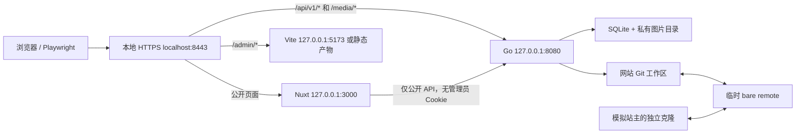

# 本地服务联调规范

版本：1.1；日期：2026-11-17。适用于[开发计划](development-plan.md) P1–P7。P1 的工程、站主认证及 HTTPS 环境已实现并验证，见[本地开发说明](development/p1-local.md)及[实际记录](verification/P1-2026-11-17.md)。下文保留全阶段目标，内容、Git 同步、评论、生产替换与恢复矩阵按后续阶段验收。

## 1 服务拓扑与数据隔离

| 项目 | 开发默认值 | 要求 |
| --- | --- | --- |
| 浏览器入口 | `https://localhost:8443` | API、管理端、公开站同源；Origin 包含实际端口 |
| 内部端口 | Nuxt 3000、Vite 5173、Go 8080，仅回环监听 | 占用则配置其他端口并记录，不停止无关服务 |
| HTTPS 代理 | Caddy，本地 CA 或已受信开发证书 | 显式配置 Origin 和开发 HMR；管理端深链接不吞 API 404；不开放无用管理端口 |
| 开发数据 | `var/local/{db,assets,git,logs,certs,run}` | 可持续本地开发，不混入自动测试 |
| 测试数据 | `var/test/<run-id>/`，含 db/assets/logs/git/run | 每次测试独立；并行代理分别建目录并分配端口 |
| Git 测试环境 | bare remote + 网站克隆 + 站主克隆 | 指定分支，真实 fetch/commit/push，禁止 force push |
| 备份恢复目标 | 同一次运行中的独立 restore 目录 | 不覆盖开发数据库；原图和配置一起校验 |

持久内容、邮件、账号和密钥全部使用测试数据。测试账号通过 CLI 初始化；密码/token 不写入仓库或普通日志。自动化用例可以在初始化时构造测试夹具，验证业务行为时必须通过对应真实 HTTP API，不直接改 SQL 伪造成功结果。故障注入、DB 断言及备份校验可读取测试库，其目的与写入范围必须记录。

## 2 HTTPS、会话与权限

- 本地使用与部署一致的 `__Host-site_session` 属性：Secure、HttpOnly、SameSite=Lax、Path=/、无 Domain。不能为方便测试改成明文 Cookie。
- 浏览器和自动化运行环境明确信任测试 CA；命令行客户端用明确的 CA 文件。系统或浏览器证书信任操作单独说明，不偷偷修改全局信任。
- 不能用 `curl -k`、关闭 TLS 证书校验、Playwright 全局忽略 HTTPS 错误、关闭 Origin/CSRF 或伪造站主权限取得通过记录。暂时的 TLS 排障结果不能算会话验收通过。
- Nuxt SSR 直连固定 Go 内部地址只访问公开 API，不携带浏览器 Cookie；内部 HTTP 回环通信不代表浏览器可以绕过 HTTPS 入口。
- 正常流程用受信入口，恶意 Origin、无 CSRF、过期会话、未登录等作为负例发送，并核对响应及数据库未改变。

## 3 命令入口与实施状态

下列入口除 `test:release` 外均已在 P1 实现，从项目根目录使用 `sh scripts/dev/with-tools.sh pnpm <命令>` 执行。功能覆盖随阶段扩展：P1 的 prepare 只创建站点设置、测试站主、证书与 bare remote，不生成业务内容；integration 只验证站点和认证。安装依赖见本地开发说明。

| 命令 | 动作与覆盖范围 |
| --- | --- |
| `pnpm dev:doctor` | 检查锁定工具及 Git/OpenSSL 版本；端口由 up 检查，SQLite 与 schema 由 prepare/CLI 诊断，不静默升级全局工具 |
| `pnpm dev:prepare` | 为明确的本地运行目录执行 Goose 迁移、初始化站点与测试账号、准备 bare remote 与证书；只操作带项目标识的目标，重复执行不重置已有数据 |
| `pnpm dev:up` | 启动本次 Nuxt、Vite、Go、HTTPS 代理；记录 PID/日志，等待就绪；失败清理本次创建的进程 |
| `pnpm dev:status` | 输出实际入口、端口、健康状态和日志位置，不输出凭据 |
| `pnpm dev:down` | 只停止当前运行记录所属的进程；保留数据；不能用宽泛的进程名匹配停止其他项目 |
| `pnpm check` | 格式/lint、类型、Go vet、合同和生成产物一致性；可按变更路径执行子任务 |
| `pnpm test:integration` | 在独立目录启动 Go/SQLite、Nuxt、Vite 与 HTTPS 代理，准备 bare remote，执行真实 HTTP 认证用例；后台任务与 Git 往返在后续阶段加入 |
| `pnpm test:e2e` | 启动完整本地 HTTPS 服务，由 Playwright 驱动匿名/站主浏览器流程；关闭请求 mock |
| `pnpm build` | 分别构建公开站、管理端、Go 产物，允许各自单独构建 |
| `pnpm test:release`（P7 待实现） | 使用生产构建与本地代理复跑关键路径、兼容前端替换、备份恢复，不向外部发布 |

前端入口可以编排 Go 和 Python 工具，但不能将后端构建绑定到前端产物；Go 模块保留独立命令。迁移由显式准备/部署步骤执行，应用启动只检查 schema，不自动修改真实运行库。

健康检查区分进程存活与就绪。内部探针由 P1 实现且不经公开代理暴露；数据库/schema/资源目录异常影响就绪，Git 远端不可用只影响同步状态，不导致整个公开站不可用。脚本使用有期限的就绪轮询，不用固定长时间 sleep 代替。

## 4 测试夹具

| 夹具 | 用途 |
| --- | --- |
| 技术与生活文章，已发布/修改稿/回收站状态各有样例 | 首页、分类、搜索、可见性与状态转换 |
| 不同标题、摘要、分类、封面的公开版和修改稿 | 检查列表、详情、SSR、搜索、分享及图片不会串版本 |
| 项目、唯一个人资料、两组技能 | 四类内容读写、排序和同步 |
| Markdown 标题、表格、代码、多图、HTML 注入文本 | 目录、复制、排版、渲染清洗 |
| 图片：合法、超大小/像素、伪造 MIME、缺失、重复摘要 | 上传校验、派生图、引用保护、删除竞争 |
| 两名匿名访客、一名站主，隐藏根及隐藏回复，虚构邮箱 | 回复、身份、防越权、隐私、组管理 |
| 网站和站主克隆从同一基线各做不同修改 | B/L/R 冲突、合并、删除与修改竞争 |
| 持久任务、过期租约、已删除对象 tombstone | 崩溃恢复、重放、旧 worker、防复活 |

性能用数据集单独生成并记录文章/版本/图片/评论数量及大小；不得把少量功能夹具通过宣称为容量验证。

## 5 必须执行的联调矩阵

| 编号 | 真实操作与故障 | 通过条件 | 阶段 / 需求 |
| --- | --- | --- | --- |
| L01 | HTTPS 登录、刷新、多标签、退出、CLI 改密；错误 Origin/CSRF | Cookie 属性正确，会话失效生效，无越权；输入不丢 | P1/P7，AC18、AC30 |
| L02 | 四类内容创建，保存不完整修改稿，再补齐发布 | 保存可成功，发布校验明确；公开只见有效版本 | P2/P4，AC02、AC28 |
| L03 | 已发布内容修改标题/摘要/分类/图片但只保存 | 页面、API、SSR payload、搜索、分享、sitemap 均维持公开版本；草稿图片不可匿名取 | P2/P4，AC05、AC22、AC27 |
| L04 | 公开站六入口、详情、分类标签与标题摘要搜索 | 空状态/分页正确；只在正文出现的词不命中；代码复制和目录定位正确 | P4，AC01–AC04 |
| L05 | 两标签并发保存；同键重发、同键不同内容、响应丢失 | CAS 失败回滚，重复提交不增版本/任务；结果不明复用键；重放后取当前状态 | P2/P7，AC11、AC18 |
| L06 | 发布历史 revision 时存在更新修改稿；改 slug 后撤回 | 更新的修改稿保留；公开时旧路由正确跳转，撤回后新旧路径均 404 | P2/P4，AC05、AC27 |
| L07 | 网站保存/发布，站主克隆拉取；克隆改后推送 | 真实 Git 往返，四类完整快照及首次时间不漂移；无改动对账不产生提交 | P3/P6，AC06–AC09、AC22 |
| L08 | 拒绝 Git push/远端不可访问后发布、撤回和回收站；恢复连接 | 网站立即生效；失败可见可重试；无回滚、重新公开或循环提交 | P3/P6，AC07、AC11、AC23 |
| L09 | 两端编辑同一对象，分别选择本地/远端/手动合并和明确动作 | 保留 B/L/R；202 后能查结果；选择远端不隐含发布；网站公开状态符合动作 | P3/P6，AC10 |
| L10 | 提交解决意图后修改本地/远端，或让 fetch 失败 | 旧意图被拒绝或回到可处理状态，不套用过期解决；后续 push 竞争不覆盖新远端 | P3/P6，AC10、AC25 |
| L11 | 仓库移动/重命名、删除修改稿、删除对象；删除与编辑并发 | 稳定 id 和评论保留；丢弃草稿不撤回；无冲突删除进回收站；竞争进入冲突 | P3/P6，AC09、AC13、AC25 |
| L12 | 两端回收站恢复、彻底删除，再重放旧任务或旧文件 | 恢复未发布；删除清理旧幂等正文；tombstone 阻止复活 | P4/P6，AC24–AC26 |
| L13 | 持久任务运行中终止进程、租约过期、push 后 DB 确认前退出 | 重启对账真实 Git，旧 worker 不能覆盖新状态，无丢失或重复业务写入 | P3/P6，AC11、AC26 |
| L14 | 导入格式错、重复 id、非法路径/符号链接、缺图、未知字段；合法新对象缺 id、已有对象删除 id 后推送 | 报可定位错误，旧公开版本不变；合法新增原子分配并回写 id；已有对象丢标识不重复创建、不误判原对象删除，评论关联保留 | P3/P6，AC12、AC13 |
| L15 | 后台上传/克隆拉取，本地添图推送；私密图访问、共享引用、历史引用、删除后重传 | 双向引用正确；不可见图片不能匿名取；被保护图片不误删；公开引用仍在时可访问 | P4/P6，AC19、AC27 |
| L16 | 分类改名/迁移/删除；预览后另端修改内容或 token 到期 | 分别派生公开/修改稿；历史不改；影响变化拒绝；回收站不被公开 | P4/P7，AC04、AC22、AC27 |
| L17 | 两访客和站主在文章/留言板互相回复，提交虚构邮箱和同站主昵称 | 立即公开且平铺；只有认证站主带标识；公开 HTML/API/payload/Git/普通日志无邮箱 | P5，AC14–AC16、AC29 |
| L18 | 隐藏根/单回复、恢复根、删回复/根；预览后新增回复；跨线程回复 | 组操作与计数一致；回复自身隐藏保留；目标昵称保留；过期影响/跨线程被拒 | P5，AC17、AC29 |
| L19 | 评论提交时文章撤回，或隐藏后重放匿名幂等响应；超频/超长/网络失败 | 当前权限先校验，无旧正文泄漏；明确错误与 Retry-After；输入保留 | P5/P7，AC05、AC18 |
| L20 | 360/768/1440 宽度、键盘导航、编辑页离开/失效、后台任务轮询 | 页面无整体横向溢出；代码表格局部滚动；焦点可见；保护未保存输入；离页停轮询 | P4/P5/P7，AC20 |
| L21 | 备份真实运行数据库及原图/配置，恢复到新目录并重启对账 | 内容、图片、互动、关联可读；无旧租约卡死；不只复制活跃 db 文件 | P7，AC21 |
| L22 | 三端独立构建；本地生产产物运行；只替换兼容前端版本 | 不重新编译/发布 Go；API 与认证正常；静态深链、SSR、受控资源路径正确 | P1/P7，AC30 |
| L23 | 真驱动并发写、数据库繁忙、约束失败；过期记录清理 | 回滚完整；明确 busy 错误；外键开启；历史/冲突/待处理任务不被清理 | P1/P2/P6/P7，AC11、AC26 |

故障注入只作用于本次隔离的进程、临时 remote 和文件。可以使用受控代理/测试 hook 模拟超时、连接断开、进程崩溃或 push 拒绝；业务处理仍须走真实 Go、SQLite、Git。仅让函数返回预设成功/失败的单元 mock 不构成 L08–L13 的完整证据。

## 6 证据、判定与清理

每个阶段将记录保存到 `docs/verification/P<阶段>-<日期>.md`，至少包含：

1. 目标及对应任务/L 编号/AC；验证时间、提交或未提交文件范围。
2. 操作系统/架构、Node/pnpm/Go、实际 SQLite 引擎、Git、浏览器版本。
3. 数据目录、入口及端口、夹具规模、执行命令、受信证书方式。
4. 真实结果：HTTP 状态与业务码、脱敏请求、关键页面、数据库/任务/Git 断言；失败与未执行单列。
5. 日志、截图或 trace 的位置，以及已知限制、保留服务和停止方式。凭据、邮箱和正文不得进入可提交报告。

判定使用“通过 / 失败 / 未执行”，不能把缺依赖写成通过。原始 trace 和含私密测试载荷的日志保留在被忽略的运行目录；提交报告使用必要的脱敏摘要。自动测试结束清理自己启动的服务；排障需保留时说明原因、PID 和停止命令。

本地通过仅证明所记录环境。真实域名、外部仓库认证、生产网络、容量和恢复指标在部署环境补验；不影响在本地持续开发和完成上述功能验证。
