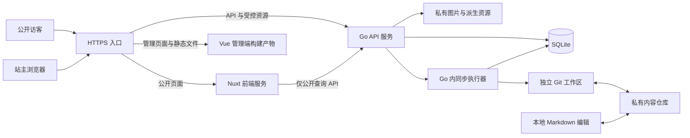

# 个人网站轻量技术方案

版本：1.3 技术设计基线  
日期：2026-11-23  
需求依据：[个人网站需求文档 v1.3](personal-website-requirements.md)  
状态：已选定前后端分离路线并完成详细设计，尚未实施生产后端

本文件保留整体架构说明。已完成的字段、表、完整接口及仓库规则见[开发详细设计](design/README.md)；具体实现以该详细设计、OpenAPI 和迁移文件为准。

## 1 推荐方案

采用 **Nuxt 公开网站 + Vue 3 / TypeScript / Vite 管理端 + Go REST API + SQLite + 本地资源目录 + Git CLI**，落实前后端分离。前端负责页面、路由与交互，Go 负责业务规则、认证、持久化和同步；双方通过版本化 HTTP API 通信，独立构建、发布和回滚。

公开网站采用 Nuxt 的服务端渲染，由独立的前端 Node 进程生成页面 HTML；管理端构建为静态单页应用。Go 不渲染页面、不嵌入前端构建产物。前端服务端渲染仍属于前后端分离：页面运行在前端服务，数据和业务只来自 Go API。[Nuxt 渲染模式](https://nuxt.com/docs/4.x/guide/concepts/rendering)

生产环境建议先在一台服务器上运行一个 Nuxt 实例和一个 Go 实例，反向代理提供 HTTPS、管理端静态托管及路径转发。后端保持模块化单体，首版不引入 Redis、独立消息队列、微服务或独立数据库服务器；任务持久化在 SQLite，由 Go 内受控执行器处理。语言选择不包含 Java。

主要代价是 Go 与 TypeScript 两套工具链，以及公开网站的 Node 常驻进程。相较原方案，前端部署不再依赖重新编译 Go；但“前后端分离”不意味着零额外运行成本，也不要求首版分域名或分服务器。

### 1.1 方案对比

| 前端方案，均配独立 Go API | 运行构成 | 适用情况 | 本项目取舍 |
| --- | --- | --- | --- |
| Nuxt 公开站 SSR + Vue 管理端 SPA | Node 前端、Go 后端、管理端静态文件 | 阅读与搜索收录兼顾，内容更新不需要重建前端 | 推荐 |
| Vue 公开站与管理端均为 SPA | Go 后端、两套前端静态文件 | 更重视运行组件少，接受正文依赖浏览器取数 | 可行备选，需另行解决初始 HTML 与分享摘要 |
| 公开站静态生成 + Vue 管理端 SPA | Go 后端、前端静态文件、内容更新后的构建任务 | 内容变更较少，可接受发布等待构建 | 首版不选；发布、撤回与缓存清理增加协调环节 |

上述取舍依据本项目的公开阅读、搜索收录和及时发布要求，不是框架性能排名。Nuxt 支持 Node 服务与静态部署；本方案选择 Node SSR，并保留全部业务 API 在 Go 中。[Nuxt 部署](https://nuxt.com/docs/4.x/getting-started/deployment)

## 2 系统边界与部署结构



- Nuxt 与 Vue 管理端均只通过 API 访问业务数据，不读取 SQLite、内容仓库或私有资源目录；前端进程不持有仓库凭据。
- Go 是内容公开状态、权限、评论、版本和同步的唯一业务权威。Markdown 转换与清洗是内容处理，不承担页面模板渲染。
- Nuxt 不建立第二套业务 API、数据库访问或 Git 任务；服务端仅为公开页面取数与渲染。管理端预览调用 Go 接口，与正式正文复用渲染管线。
- 首版公开页、后台和 API 通过同一域名进入，前后端部署单元相互独立。
- Git 工作区属于服务，不能复用站主日常开发的工作目录。
- 本轮 Sites 在线地址只托管静态原型，不是上述生产后端。原型的浏览器存储和模拟同步不能代替 SQLite、认证或 Git 执行器。

### 2.1 路由归属

以下按匹配优先级分流，路径不能被公开站或管理端的页面回退规则吞掉。

| 外部路径 | 负责组件 | 规则 |
| --- | --- | --- |
| `/api/v1/*` | Go | 业务 API、会话、上传与同步管理；未知接口返回 JSON 404 |
| `/media/*` | Go | 每次按当前公开引用校验；私有预览使用管理 API |
| `/admin`、`/admin/*` | 代理静态托管 | 管理端构建基路径为 `/admin/`；页面深链接回退到管理端入口，缺失资源返回 404 |
| `/_nuxt/*` | Nuxt 静态资源 | 仅有内容摘要的构建资源可长缓存 |
| 其他公开页面及 `/sitemap.xml`、`/robots.txt` | Nuxt | 页面数据来自公开 API；未公开内容返回 404，API 故障返回 503，不伪装成空白成功页 |

Nuxt 服务端通过仅在服务端配置的内网 API 地址请求 Go，浏览器通过同源 `/api/v1` 请求。公开 SSR 请求不转发站主 Cookie，也不调用管理 API；只有公开字段可以进入 HTML、页面数据载荷及页面元信息。页面取数采用 `useFetch` 或 `useAsyncData` 管理服务端数据向浏览器交接，提交操作单独发请求。[Nuxt 数据获取](https://nuxt.com/docs/4.x/getting-started/data-fetching)

## 3 组件与代码组织

| 层 | 建议组件 | 边界 |
| --- | --- | --- |
| 公开前端 | Nuxt、Vue 3、TypeScript | 页面、SEO 元信息、公开数据获取和交互；独立 Node SSR 服务 |
| 管理前端 | Vue 3、TypeScript、Vite、Vue Router | Markdown 编辑和管理交互；独立静态构建产物 |
| 后端 HTTP | Go `net/http`、JSON、OpenAPI 合同 | 模块化单体 API；不包含前端模板或构建产物 |
| 数据访问 | `database/sql`、显式 SQL、版本化 migration | 初期不增加大型 ORM |
| SQLite 驱动 | `modernc.org/sqlite` | 便于无 CGo 构建，锁定兼容依赖并检查实际 SQLite 引擎 |
| Markdown | Goldmark、代码高亮扩展、HTML 允许列表清洗 | 默认禁止原始 HTML，保留 Markdown 原文 |
| 任务 | SQLite outbox、应用内单同步执行器 | 重启可恢复，网络请求不占用写事务 |
| 资源 | 本地私有目录、内容摘要寻址 | 通过应用验证公开引用后返回 |
| HTTPS | Caddy 或已有反向代理 | 自动证书与续期配置在部署阶段验证 |

```text
frontend/apps/web/         # Nuxt 公开网站，独立构建与运行
frontend/apps/admin/       # Vue + Vite 管理端，独立静态构建
frontend/packages/api-client/ # 从 OpenAPI 生成的 TypeScript 类型与请求封装
frontend/packages/ui/      # 共享色彩、排版与基础组件，按需抽取
backend/cmd/api/           # Go API 与内置任务执行器入口
backend/internal/content/  # 内容、版本、公开查询
backend/internal/comments/ # 评论与留言
backend/internal/auth/     # 站主身份与会话
backend/internal/media/    # 资源、引用、派生图
backend/internal/sync/     # 文件协议、三方比较、Git 执行器
backend/internal/jobs/     # 任务领取、重试与恢复
backend/internal/store/    # SQL 与事务
backend/migrations/        # 数据库迁移
contracts/openapi.yaml     # 已形成的 API 详细合同
deploy/                    # 代理规则与各服务部署配置
```

P1 工程与认证已完成。2026-11-23 调整为根仓库维护唯一的 `contracts/`、`docs/`、整体编排及跨服务测试，前后端分别为 Git 子模块，根提交固定两个子模块的提交版本。前端共享包和应用位于前端子模块，Go 代码与迁移位于后端子模块，各自具有独立检查和构建入口；完整合同验证及端到端联调使用根工作区。当前 `prototype/` 继续作为静态交互评审产物，私有内容同步仓库独立于应用子模块。

部署前锁定 Go、Node、前端依赖、渲染器与 SQLite 驱动版本。构建产物记录工具链、Git commit 及 `sqlite_version()`；本方案不将调研当日看到的版本直接视为永久锁定清单。[SQLite 驱动文档](https://pkg.go.dev/modernc.org/sqlite)

## 4 内容模型

### 4.1 核心表

| 表 | 关键职责 |
| --- | --- |
| `content_objects` | 稳定 id、类型、slug、生命周期、公开与修改稿版本指针、generation、时间 |
| `content_revisions` | 不可变标题、摘要、正文、分类标签、封面、资源引用、规范化摘要 |
| `taxonomy_items` 与 `revision_taxonomy` | 分类标签目录及各内容版本的名称、slug 快照 |
| `asset_blobs` 与 `revision_assets` | 原始文件、派生文件、MIME、大小以及版本引用 |
| `comments` | 文章或留言板来源、根留言、回复目标、昵称、正文、隐藏状态、时间、站主标识 |
| `comment_contacts` | 可选私密邮箱，与公开序列化对象分开 |
| `sync_bases` 与 `sync_conflicts` | 每对象最近共同快照、两端冲突版本及解决状态 |
| `outbox_jobs` | 目标 generation、操作、状态、租约、尝试次数、下次时间、错误摘要 |
| `repo_events` | 事件去重与已处理分支版本 |
| `tombstones` | 已删除对象的最小身份和版本信息，阻止旧事件复活 |
| `admin_users` 与 `sessions` | 单站主账号与服务端会话，不进入内容仓库 |

公开版本和修改稿均为完整快照。公开详情、列表、搜索、分类、分享摘要及图片授权，只使用当前公开版本；不能从修改稿取标题或封面再与公开正文拼接。

### 4.2 生命周期

| 操作 | 本地事务 | 公开表现 | 仓库处理 |
| --- | --- | --- | --- |
| 保存修改稿 | 写入版本，更新 draft 指针，写入 outbox | 不变 | 同步修改稿 |
| 发布 | 校验资源，更新 published 指针与 generation，写入 outbox | 事务成功后生效 | 异步同步，不阻塞网站 |
| 撤回 | 更新不可公开状态及 generation，保留版本和评论 | 立即下线 | 异步同步撤回 |
| 移入回收站 | 标记 trash，保留版本与引用 | 立即下线 | 移除仓库正常对象文件 |
| 恢复 | 恢复到未发布状态，保留稳定 id 与评论关系 | 仍不可见 | 同步未发布对象 |
| 彻底删除 | 删除业务数据，保留最小 tombstone | 不可见 | 异步清理，不清除 Git 历史 |

内容变更与 outbox 写入必须处于同一事务。进程不能在“网站已经发布、任务尚未落库”之间留下不可恢复的空隙。图片先存储并验证完整性，再提交引用；孤立临时文件由受控清理任务回收。

## 5 双向同步文件协议

首版使用一个私有仓库、一条指定分支。建议目录如下，最终以版本化 schema 固定：

```text
content/
  schema.json
  posts/<stable-id>/
    object.json
    published.md
    draft.md
  projects/<stable-id>/...
  profile/<stable-id>/...
  skills/<stable-id>/...
assets/<sha256>.<ext>
```

`object.json` 定义对象身份、类型、schema 版本、slug 和公开状态。`published.md` 与 `draft.md` 各自包含可编辑字段和正文，两者不得共用一份随草稿变化的标题或摘要。

```json
{
  "schema_version": 1,
  "id": "post-example-id",
  "kind": "article",
  "slug": "small-architecture",
  "visibility": "published",
  "published_file": "published.md",
  "draft_file": "draft.md"
}
```

```markdown
---
title: 把个人网站做轻
summary: 一份关于单体服务与内容维护的记录。
channel: tech
category: engineering
tags: [go, writing]
cover: ../../../assets/example-hash.webp
published_at: 2026-11-15T12:00:00Z
---
## 从一个清楚的问题开始
这里是 Markdown 正文。
```

- 保存 `draft.md` 不影响公开版本；更新 `published.md` 且对象仍标记为公开，才触发网站更新。
- 撤回修改对象公开状态，保留历史版本；不是把修改稿标记当成撤回标记。
- 对象完整删除才进入回收站；单独删除 draft 表示丢弃修改稿，删除仍被引用的资源导致校验失败。
- 稳定 id 随移动保留；同一仓库快照中移动目录不视为删旧建新。
- 新对象可通过模板生成 id；缺少 id 的新增导入需原子地生成并回写。已知对象丢失 id 进入错误处理，不直接当成新对象。
- schema 外的字段必须无损保留或明确拒绝，不静默丢弃。
- 文件路径规范化后必须位于允许的内容或资源目录，拒绝越界路径和符号链接读取。Markdown 图片可使用受控相对引用；不将本地任意文件加入提交。
- 时间统一保存为带时区的时间，前台按站点时区显示；首次发布时间保持稳定。

评论、私密邮箱、数据库、账号、会话、仓库凭据、运行日志和回收站备份不写入内容仓库。

## 6 同步执行与冲突

### 6.1 执行器

应用启动时获取单机工作区文件锁，避免多个实例同时修改克隆目录。任务领取采用短事务与租约；崩溃后可重新领取超时任务。Git 网络操作发生在数据库事务之外。

推荐 webhook 通知与定期对账组合：通知只表示“需要检查分支”，执行器读取当前分支 HEAD；不按通知到达顺序直接重放旧文件。提供方未知时，先实现定期对账，再接入一个提供方的签名验证适配器。

初始建议：每 60 秒对账一次；网络失败使用带抖动的退避，最多自动尝试 5 次，之后保留任务等待人工重试。凭据失效直接提示修复。以上为可配置初值，不是实测时效保证。

### 6.2 按对象三方比较

B 为最近共同快照，L 为网站当前对象快照，R 为当前仓库对象快照。快照包含公开状态、版本、分类标签、资源引用和删除状态；比较前排除纯展示性的同步时间字段。

| 条件 | 处理 |
| --- | --- |
| R = B，L 改变 | 将网站变化写入仓库 |
| L = B，R 改变 | 导入仓库，按版本用途保存或发布 |
| L = R | 标记已收敛，不重复提交 |
| L、R 都改变且不同 | 保存 B、L、R，标记冲突，不自动合并 |

冲突保留网站当前已经生效的公开或下线状态。站主可以选择一端或编辑合并；默认只保存修改稿。明确选择发布、撤回或回收站后，才执行该动作。

### 6.3 并发与故障恢复

1. fetch 指定分支，记录远端 HEAD，并基于该 HEAD 修改通过比较的对象。
2. 工作区构建提交前后均检查网站 generation，过期任务不能宣称同步了新状态。
3. 使用普通 fast-forward push，不使用 force。远端前进导致拒绝时重新 fetch 和三方比较，不覆盖其间的提交。
4. push 后才记录共同快照。若网站期间又发生修改，共同快照只代表实际推送的那一版，新 generation 保持待同步。
5. push 成功但数据库标记前崩溃时，重试通过对象摘要与操作标识识别已经完成的写入。
6. 自身提交、重复 webhook、迟到事件不产生循环提交；删除记录及较新本地变更阻止旧事件重新公开内容。
7. 彻底删除后的同 id 内容不得被旧事件自动重建；显式重新创建应使用新 id，回收站恢复则保留原 id。

本地 `git update-ref` 的旧值比较只保护本地引用，不能代替远端普通 push 的并发保护。[Git push](https://git-scm.com/docs/git-push)、[Git update-ref](https://git-scm.com/docs/git-update-ref)

## 7 接口与访问边界

接口使用 `/api/v1` 前缀，已形成 [OpenAPI 合同](../contracts/openapi.yaml)。下表保留分组概览；完整路径、字段与具体状态以合同和[交互规则](design/interaction-contract.md)为准，尚未实现服务。

| 接口分组 | 示例 | 规则 |
| --- | --- | --- |
| 公开查询 | `GET /api/v1/public/articles?q=&channel=&page=`、`/articles/{slug}` | 标题与摘要搜索；分页；按首次发布时间倒序；详情返回已清洗正文和目录 |
| 其他公开内容 | `/api/v1/public/profile`、`/skills`、`/projects`、`/taxonomy`、`/sitemap` | 只返回当前公开快照及链接；Nuxt 组装页面和站点地图 |
| 公开互动 | `GET/POST /api/v1/public/comments` | 查询分页；提交校验昵称正文、幂等键与限频；不返回邮箱 |
| 管理认证 | `GET/POST/DELETE /api/v1/admin/session` | 查询当前身份与 CSRF token、登录、退出；会话由 Go 管理 |
| 内容管理 | `PUT /api/v1/admin/contents/{id}/draft` | 使用 generation 条件更新，过期编辑返回冲突 |
| 发布操作 | `POST /api/v1/admin/contents/{id}/publish` | 校验拟发布版本；公开生效与同步结果分别返回 |
| 撤回与回收站 | `/withdraw`、`/trash`、`/restore`、`/purge` | 明确操作语义，不把所有动作混为保存 |
| Markdown 预览 | `POST /api/v1/admin/preview` | 与正式正文同一渲染管线，禁止共享缓存 |
| 同步管理 | `/api/v1/admin/sync/jobs`、`/conflicts/{id}/resolve` | 解决冲突校验最新两端版本 |
| 资源 | `/media/{hash}/{variant}`、`/api/v1/admin/media` | 前者只提供公开引用；上传和私有预览走需会话的管理 API |

表中并列的短路径沿用所在分组前缀；撤回与回收站动作位于 `/api/v1/admin/contents/{id}` 下，同步冲突处理位于 `/api/v1/admin/sync` 下。OpenAPI 合同已写出完整路径与 HTTP 方法。

### 7.1 接口合同与错误处理

- Go 返回业务数据、清洗后的正文 `body_html`、目录 `toc` 及必要版本标识；不返回页面模板。前端不从数据库结构推导业务状态。
- 列表固定返回 `items`、`page`、`page_size`、`total`，服务端限制单页大小；首版搜索范围仍仅标题和摘要。
- 错误使用 `code`、`message`、`field_errors`、`request_id`；未登录返回 401，无权限或 CSRF 校验失败返回 403，版本冲突返回 409，字段无效返回 422，限频返回 429。
- 保存与发布提交预期 `generation` 和明确的目标版本；409 后保留输入并提示重新比对。按钮防重复点击不能替代服务端幂等控制。
- 发布成功响应包含 `published_revision_id` 和 `sync_status`。本地事务成功但 Git 失败仍是发布成功，前端独立提示同步失败。
- 前后端可独立发布，`v1` 内优先新增可选字段并保持旧字段语义；破坏性变更先做兼容过渡或新增 API 版本。合同类型检查与真实接口校验列入集成验证。

### 7.2 登录与同源访问

站主登录采用 Go 管理的随机会话，Cookie 设置 `HttpOnly`、`Secure`、`SameSite=Lax`、`Path=/` 且不设置宽泛 Domain；不把登录 token 放入 localStorage。管理端查询会话取得 CSRF token，写操作携带 token，并由 Go 校验；登录接口校验请求来源并限频。密码通过成熟哈希库保存。首版不做 OAuth 访客账号体系，站主回复走已认证管理接口，公开昵称不代表认证身份。

同域名反向代理下，前端直接访问 `/api/v1`，不需要开放浏览器跨域访问。开发环境由各前端开发服务器代理 API，Nuxt SSR 使用服务端 API 地址。未来若拆成不同来源，单独配置精确来源白名单、凭据和 Cookie 策略，不使用任意来源加凭据的配置。前端路由守卫只负责跳转和提示，实际管理权限每次由 Go 检查。

公开评论 DTO 采用字段允许列表，私密邮箱不进入公开响应、缓存或搜索。父留言隐藏会使整组在公开查询中不可见，恢复不覆盖各回复原有的单独隐藏标记。

## 8 Markdown 与资源

保存 Markdown 原文；Go 在预览和发布时使用同一管线生成并清洗 HTML，返回正文及目录。Nuxt 和管理端只在专用正文组件中展示该 `body_html`；标题、摘要和评论采用 Vue 普通文本插值。禁止把用户内容作为 Vue 模板编译，也不允许将未经清洗的内容传给 `v-html`。Goldmark 默认不输出原始 HTML，正式实现保留该边界。[Vue 安全说明](https://vuejs.org/guide/best-practices/security.html)、[Goldmark 安全说明](https://github.com/yuin/goldmark#security)

原始图片保存在非公开目录，引用元数据关联内容版本。公开图片请求检查是否被当前公开版本引用，草稿预览走站主会话。回收站引用继续保护资源，不能被“未使用图片清理”误删。

首版候选限制：上传接受 JPEG、PNG、WebP，单文件 10 MB；验证真实格式、尺寸及解码结果。可信静态设计图可以使用随应用发布的 SVG，访客和内容上传不开放任意 SVG/HTML。图片变体在受限并发任务中生成，失败保留原图并记录状态。

首版不依赖 CDN。公开动态页面、业务 API、页面数据载荷和受控内容图片使用 `Cache-Control: no-store`，不启用页面静态生成、SWR、ISR 或持久页面缓存；撤回后新请求按当前公开状态检查。浏览器页面跳转、返回页面或恢复焦点时重新获取公开数据，不无限复用已经失效的路由数据。后台、草稿和预览同样不存储响应。

只有带内容摘要且不含业务内容的 JS、CSS、设计图标可以长缓存。此方案优先简化及时撤回的验收，后续需要缓存时再设计失效机制；已经被访客加载、截图或另行保存的内容无法远程收回。具体图片限制和缓存参数在实现前写入配置及验收用例。

## 9 SQLite 与备份

SQLite 使用本机持久磁盘、WAL、外键约束、短事务和 busy timeout。WAL 支持读写并行，但同一时刻只有一个写者，不用于多主机共享网络文件系统。扩展到多个写入实例时再评估 PostgreSQL。[SQLite WAL](https://www.sqlite.org/wal.html)、[SQLite 适用范围](https://sqlite.org/whentouse.html)

上线核对实际 SQLite 引擎版本与官方已知问题，确保包含 WAL-reset 等相关修复；驱动版本号不能代替运行时验证。

在线备份使用 SQLite Backup API 或 `VACUUM INTO`，同时保存原始资源、回收站仍引用的资源以及必要配置，不仅复制正在运行的 `.db` 文件。资源采用不可变摘要文件，备份期间暂停资源物理清理，保证数据库快照引用的文件均进入备份。[SQLite 在线备份](https://www.sqlite.org/backup.html)

建议初始备份策略为每日一次、保留 14 天日备份和 4 份周备份，并保存一份异机副本。RPO 24 小时、RTO 4 小时作为候选目标，需通过恢复演练确认；回收站不自动清空与备份留存策略分别管理。这些是方案建议，不是当前已具备的恢复能力。

## 10 部署与质量验证

建议首版部署到带持久磁盘的 Linux 单机，Nuxt 和 Go 分别以 systemd 服务或独立容器运行，二者择一；管理端由反向代理托管静态文件。不要求 Kubernetes。Go 绑定内网或回环地址，SQLite、原始图片与 Git 工作区仅挂载给后端；前端不能直接读取这些目录。

| 交付单元 | 产物与运行方式 | 发布边界 |
| --- | --- | --- |
| 公开前端 | Nuxt Node preset 的 `.output/`，以 `node .output/server/index.mjs` 运行 | 独立构建、重启和回滚；依赖兼容的 Go API |
| 管理前端 | Vite `dist/`，由代理静态托管到 `/admin/` | 独立替换版本目录；不重启 Go |
| 后端 | Go 二进制或镜像、migration，运行环境提供 Git | 独立发布；数据库和资源位于持久目录 |

生产不使用 `vite preview`，Node 在本方案中同时是构建工具与公开前端运行时。[Nuxt Node 部署](https://nuxt.com/docs/4.x/getting-started/deployment)、[Vite 静态部署](https://vite.dev/guide/static-deploy.html)

API 合同变更先发布兼容旧前端的后端，再更新前端。前端、后端各有版本与健康检查；应用回滚不能假设数据库迁移自动回滚，迁移优先保持向后兼容，必要时用演练过的恢复方案处理。前端使用公开健康检查页面，Go 另设内部存活与就绪检查，故障定位区分页面服务、业务 API 和仓库同步。

候选起步环境暂以 2 vCPU、2 GB 内存进行验证，须计入新增的 Node 常驻进程、Go 和图片任务，并在本地或 CI 构建前端。最终配置由实测决定，不据此承诺容量或费用。域名、地区、供应商与预算仍待确定。

上线前必须执行：

- 使用真实临时 Git 仓库验证公开版本与修改稿往返不丢字段。
- 在 push 前后、数据库标记前后模拟中断，验证持久任务与去重。
- 验证修改与删除冲突、旧任务、回收站恢复和旧链接。
- 验证未认证用户不能取得草稿、预览、私密邮箱或未公开资源。
- 检查 Nuxt HTML、页面数据载荷与元信息不含草稿或私密字段，撤回后新请求不返回旧内容。
- 验证正常路径刷新、管理端深链接、接口 404、公开详情 404 与 API 故障 503 的归属和状态码。
- 验证 Cookie 会话、退出、CSRF、401/403/409 的前端反馈及输入保留。
- 独立更新或回滚一个前端，后端不重建；验证兼容旧前端的 API 发布流程。
- 在约定内容规模和网络条件下测试页面、搜索与图片性能。
- 执行备份恢复与应用回滚演练，核对内容、资源和评论关系。

## 11 实施顺序

| 阶段 | 工作 | 通过条件 |
| --- | --- | --- |
| T0 工程与接口边界 | Nuxt、Vue 管理端和 Go 独立工程；OpenAPI 合同、开发代理、会话及一个公开查询 | 独立构建与启动，前端只能经 API 访问数据；AC30 通过 |
| T1 核心技术切片 | 对象与版本模型、事务 outbox、一个文章对象的双向同步 | 真实 Git 下完成保存、发布、离线重试、冲突、回收站恢复 |
| T2 内容与公开阅读 | Nuxt 六个入口、详情、搜索、元信息、Go 公开 API 与资源授权 | 对应需求 AC01–AC05、AC08、AC19 的生产实现通过 |
| T3 后台与互动 | Vue 后台、Markdown 编辑、评论管理、资料与项目编辑 | 管理操作、发布边界、评论与回复验收通过 |
| T4 上线准备 | 部署、恢复、性能与内容填充 | 约定质量指标通过，真实内容替换示例 |

当前已完成技术路线选择、交互原型、开发详细设计和 P1 工程与认证；仓库结构按根文档与前后端子模块协作。接着按开发计划 P2 验证内容双版本、异步任务和删除冲突，再扩展页面。Nuxt / Vue / Go / SQLite 路线按本轮要求采用；部署规模与供应商仍需结合实际资源确定。

更详细的官方来源核验记录见 [技术调研](technical-research.md)，页面布局与原型范围见 [页面原型设计](personal-website-prototype-design.md)。

## 12 版本记录

| 版本 | 日期 | 变更 |
| --- | --- | --- |
| 1.0 | 2026-11-15 | 形成轻量单体、内容版本、持久任务及双向同步方案 |
| 1.1 | 2026-11-15 | 按用户要求改为前后端分离；公开页面改由 Nuxt 渲染，Vue 管理端独立托管，Go 仅提供业务 API；补充接口、鉴权、缓存和独立部署边界 |
| 1.2 | 2026-11-15 | 选定推荐路线，补齐代码仓库与编码规范、交互规则、32 表 SQL、58 操作 OpenAPI 及设计验证；详细定义分文件维护 |
| 1.3 | 2026-11-23 | 根仓库统一维护 contracts/docs；前后端改为独立 Git 子模块，调整目录及跨仓库验收规则 |
